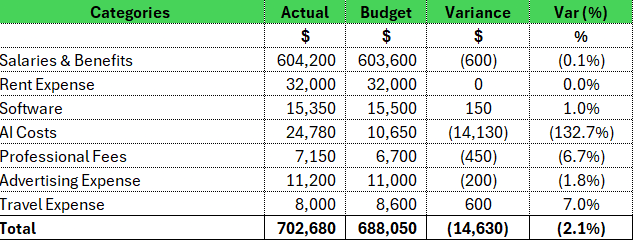
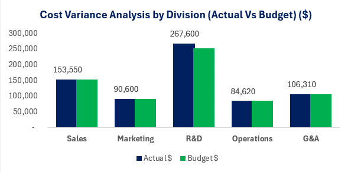
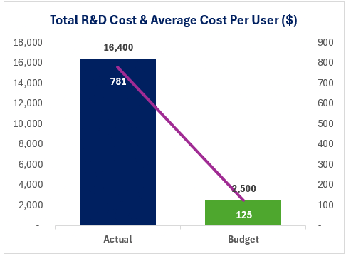
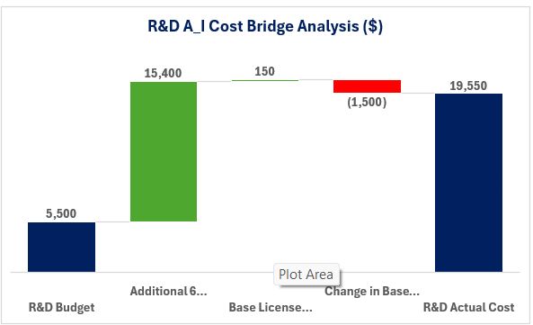
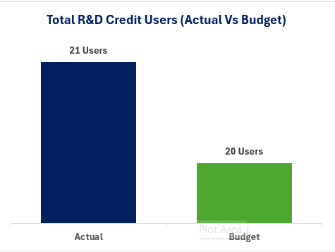

# Ambike-Financial-Inc.-Cost-Variance-Analysis

### MANAGEMENT REPORT (FY-2026) - (Actual Vs Budget)							
#### **_Consolidated Cost Variance Analysis & R&D AI Project Review (Basis: Consolidated IFRS | Currency: USD)_**						
#### 1. Executive Summary											
**Ambike Financial Inc.** recorded a consolidated FY-2026 actual expenditure of **$702,680** against a budget of **$688,050**, resulting in an unfavorable net variance of **-$14,630 (-2.1%)**. Core operational categories across Sales, Marketing, Operations, and G&A maintained exceptional discipline with a combined variance of only **-$500**. The organizational variance is overwhelmingly driven by R&D and AI cost overruns **(-$14,600 and -$14,130, respectively)**. Confirmation from the R&D President verifies this is entirely attributable to Project Catalyst—an unbudgeted client initiative onboarding 6 new engineers. Crucially, baseline R&D operations achieved -$1,500 in operational savings, proving the variance stems strictly from unbudgeted project scale.	

***
#### 2. Financial Performance								
The table below details category-level variances, demonstrating that budget deviation is isolated entirely to AI and R&D compute expansion.							

,,,,
															
															
															
															
															

