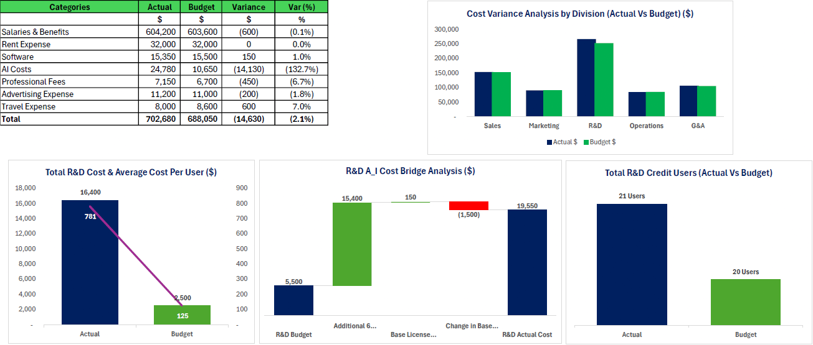

# Ambike-Financial-Inc.-Cost-Variance-Analysis

### MANAGEMENT REPORT (FY-2026) - (Actual Vs Budget)							
#### **_Consolidated Cost Variance Analysis & R&D AI Project Review (Basis: Consolidated IFRS | Currency: USD)_**						
#### 1. Executive Summary											
**Ambike Financial Inc.** recorded a consolidated FY-2026 actual expenditure of **$702,680** against a budget of **$688,050**, resulting in an unfavorable net variance of **-$14,630 (-2.1%)**. Core operational categories across Sales, Marketing, Operations, and G&A maintained exceptional discipline with a combined variance of only **-$500**. The organizational variance is overwhelmingly driven by R&D and AI cost overruns **(-$14,600 and -$14,130, respectively)**. Confirmation from the R&D President verifies this is entirely attributable to Project Catalyst—an unbudgeted client initiative onboarding 6 new engineers. Crucially, baseline R&D operations achieved -$1,500 in operational savings, proving the variance stems strictly from unbudgeted project scale.	

*****
#### 2. Financial Performance								
The table below details category-level variances, demonstrating that budget deviation is isolated entirely to AI and R&D compute expansion.							
## Dashboard

- <a href="https://github.com/funsho04/Cost-Variance-Analysis/blob/main/Financial_Performance.png">Dashboard view</a>

						

_As shown in the dashboard graphs (Divisional Variance, AI Base vs. Extra Credits, R&D User Count, Extra Credit Cost/User, and R&D Cost Bridge), actual spend across Sales, Marketing, Operations, and G&A tracks tightly to budget. R&D extra credits surged to **$16,400 (averaging $781/user vs. $125 budgeted)**, perfectly bridging the R&D cost overrun from the **$5,500** opening budget through **-$1,500** baseline savings and **+$15,400** Project Catalyst scaling to **$19,550** actual spend._																
																
*****		
#### 3. Key Observations															
• R&D President Confirmation: Official correspondence confirms the onboarding of 6 additional engineers for Project Catalyst, directly explaining the unbudgeted scale.	    														
• AI Cost Concentration: **96.6% of the company's total cost variance ($14,130 out of $14,630)** is driven by AI cost overruns, primarily within **R&D ($16,400 in extra credits)**.	

• Compute Intensity over Headcount: R&D headcount increased by just **1 user (20 to 21, +5%)**, whereas average extra credit cost surged from **$125 to $781 per user (-524.8%)**, proving workload intensity drove the variance.	  

• Underlying Efficiency: Core R&D operations achieved **-$1,500** in baseline savings, confirming standard workflows remained highly efficient.		

******
#### 4. Management Recommendations									
1. Incorporate Project Catalyst into Q4 Re-Forecast: Adjust rolling forecasts to capture ongoing project credit consumption.
       				
2. Verify Client Contract Billability: Confirm pass-through billing status for Project Catalyst compute to ensure margin recovery.									
3. Implement AI Guardrails: Establish automated spend alerts and approval workflows when credit consumption exceeds baseline allocations.									

															

